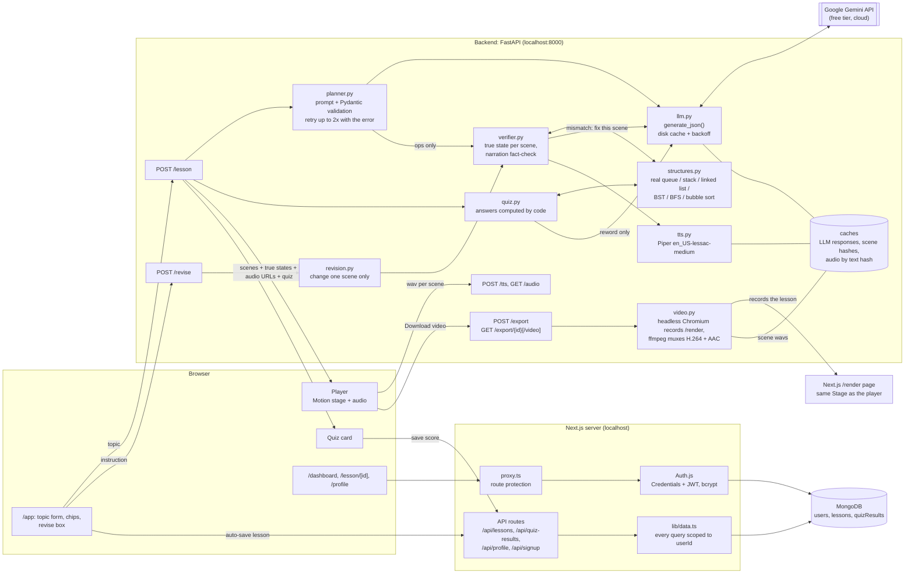

# Structura: a Data Structure Explainer

> Type a topic ("how does a queue work", "show BFS") and get an animated, narrated lesson with a short quiz.
> The LLM only **plans operations**. Real Python data structures compute every state, every sentence of narration is checked against those states, and every quiz answer is computed by code.

| Name | Roll number |
|------|-------------|
| Saroash Waseem | 22i-2609 |
| Agha Ahsan | 21i-1117 |

**Course project:** NLP Project: *Structura, a Data Structure Explainer* (grounded LLM generation with verified narration and local text-to-speech).

---

## What it does

1. **Understand the question:** `focus.py` analyses what was asked: the structure, the intent (`what_is`, `how_op`, `compare`, `trace_on_input` or `why`), the focus ("delete a node from the middle"), the one question the lesson must answer, and the operations that demonstrate it. Everything after this is organised around that focus (see [Lessons answer your question](#lessons-answer-your-question)).
   **Plan:** Gemini turns the question into a JSON scene plan made of **operations only**, for example `enqueue(5)` or `walk(20)`. It never describes or draws a state. Each scene has a role: `setup`, `core`, `edge_case` or `recap`.
2. **Use your data:** `topic_parser.py` reads your own graph ("A-B, A-C, B-D, C-D, starting from A") or values ("sort [5, 2, 9, 1]") from the topic. The plan is forced to use exactly those labels, edges and values; example data is only invented when you give none.
   **Run:** `structures.py` runs those operations on real implementations (array, queue, stack, linked list, binary search tree, graph BFS with a real queue, bubble sort) and records the true state after every step. A topic outside these (for example hash maps or heaps) gets a clear "not supported yet" message. The model is never allowed to quietly substitute a different structure.
3. **Verify:** `verifier.py` checks each scene's narration against that true state:
   - **Facts:** every number and claim must be true ("removing 10", "the front is 20", "Queue is now [C, D]", "Array is now [3, 7, 5]", "Visit B", "we compare 4 and 2 and swap them", "the list is sorted"). Number words such as "twenty one" are converted to digits first.
   - **Specificity:** a scene with operations must name its key facts, so vague lines like "we continue exploring" fail. BFS names the visited node and the queue, sorting names the compared pair and the array, stack/queue name the moved item and the new top/front, arrays name the index and value.
   - **Meaningful facts:** no "size" talk for graphs or trees. The intro must define the structure in plain words with an everyday analogy.
   - **Pointers:** linked lists are described with pointers, not arrays. Claims such as "20 now points to 40", "30 is skipped" and "head -> 10 -> 20 -> null" are checked against the real nodes, and "List is now [10, 20, 40]" is rejected for a linked list.
   - **Focus:** the first scene leads into the question (only "what is" lessons open with a definition), the recap restates the answer, and facts about unrelated operations (for example head-insert speed in a delete lesson) are rejected.
   - **Required concepts come from the question:** a "what is an array" lesson must teach that indexes start at 0, slots are fixed, access by index is instant and inserts shift items. A "delete a middle node" lesson must teach finding the previous node, rewiring its next pointer, that the removed node is skipped, and the head, tail and missing-value edge cases. Missing ideas are added as verified concept scenes.
   - All failing scenes go back to the LLM in one batched call that includes each scene's true state (up to 2 rounds).
   - If it is still wrong, the scene gets a narration generated by code from the true state, so **no unverified scene is ever shipped**.
4. **Narrate:** Piper (local) speaks each scene. **Each scene's animation lasts exactly as long as its audio.**
5. **Quiz:** 3 multiple-choice questions built from **the lesson's own data**: the same list, graph, labels and values, run on the real structure so the answer is computed by code. At least 2 of the 3 test the focus of the question (after deleting 30 from head -> 10 -> 20 -> 30 -> 40 -> null, what does 20 point to?), with computed distractors such as the deleted node. Edge-case questions are asked only when the lesson taught that edge case. The LLM may only reword a question, and any rewording that changes a number or node label is rejected.
6. **Revise:** "slow down step 4" or "explain step 3 for a beginner" changes **only that scene**. A rewrite is checked by the verifier and the beginner clarity gate before it goes in, retried once with the exact problems, and only reported as rewritten if the text really changed (similarity at most 0.9). Otherwise you get an honest "I couldn't make this step simpler, try describing what confused you". Every other scene comes back byte-identical, and the UI shows the step's narration before and after.
7. **Export a video:** **Download video** under the player makes a real MP4 on your own computer (no video API). Nothing is captured in real time: the `/render` page is a pure function of the video time and lists its keyframes (each new scene, each step, the quiz slide). Up to 4 headless Chromium pages capture one frame per still and about 12 fps only during the short animation after each change, ffmpeg holds each frame for its exact duration, and the result is muxed with the scene WAVs into H.264 + AAC at 1280x720. A 60 s lesson exports in about 8 s. The export starts in the background as soon as the lesson appears, so Download is usually instant; it can be cancelled, and it is cached per lesson and revision.
8. **Answer fit:** the analysis classifies the question's shape (list, compare, why, how, complexity, definition, when, misconception, multipart, user data, vague) and the coverage gate blocks lessons that do not answer it: a list question must name every item in its own scene (types of array: 1D, 2D grid, static vs dynamic with a real resize, jagged; each with its own view), a comparison must show both sides on the same steps and end with "use X when ..., use Y when ...", a wrong premise is answered plainly first. Vague questions get one clarifying question, unsupported topics an honest notice with the closest supported topics. The player shows "Answers your question" next to "Verified".

Every lesson is at least 30 seconds long. Short lessons get number-free sentences about the focus added, and as a last resort every scene is slowed evenly.

### Answer first, visuals second

**Priority rule: answer quality comes first.** Diagrams and animation exist only to support the answer. No scene is added just to show an operation; every scene teaches one point of the answer.

- **Answer outline:** in the same single planning call, Gemini first writes `answer_points`: 4 to 6 teaching points, each with an id, a kind, the point in one line and a visual. Then it writes the scenes, each pointing at exactly ONE answer point. Only the demo may take several scenes, and a scene that serves no point is removed.
- **"What is X" answers** follow a teacher's outline: a plain definition, an analogy, the key rule with its vocabulary in plain words (stack: last in, first out; push, pop, top), a short demo that *proves* the rule (simplest operations first: push, push, push, then pop), where it is used in real life (undo, the browser back button, function calls), and the takeaways in new wording.
- **Demos say what they prove**, using the real values: "We pop. 36 was the last one in, so it leaves first. The top is now 24." The verifier checks that the rule appears in a demo scene; the keyword groups for each structure and focus are in `concepts.py`.
- **Plain words:** jargon such as constant time, O(1), underflow, overflow, LIFO, FIFO or traversal must be explained in plain words where it is first used, or the scene is sent back for repair.
- **No repetition or padding:** a recap that re-defines the structure, or shares more than half its content words with the intro, is rejected. "What is" lessons are never padded with extra concept scenes.
- **Quiz:** one question tests the core rule in plain words ("You push 12, then 24, then 36. Which comes out first?"). One tests a real-world use or a vocabulary word, with answers from a fixed answer key, and is asked only if the lesson covered it. The last is a short computed trace on the lesson's own values.

### Lessons answer your question

| Rule (enforced in code) | How |
|---|---|
| At most 2 setup scenes | The opening sentence plus ONE `init` scene that builds the starting data ("Here is our list: head -> 10 -> 20 -> 30 -> 40 -> null"). Separate insert scenes are merged, unless the question is about inserting. |
| Core scenes fill at least 50% of the duration | Core scenes explain the mechanism step by step. If they fall short, sentences about the focus are added; many short edge-case scenes are merged into one. |
| The core operations always appear | For example, a delete lesson walks hop by hop to the node *before* the target (`walk` moves a real cursor one node at a time), then rewires its next pointer. If the LLM leaves this out, the operations are added in code and narrated with their true state. |
| The first scene leads into the question | It has about 25 words. Only "what is" lessons open with a definition and an analogy. |
| The recap restates the answer | It gives the steps or the key ideas, never the final numbers or unrelated facts. |
| Every scene serves the focus | Op scenes about other operations are dropped. Narration about unrelated operations is sent back for repair, with the reason. |

The planner prompt holds a lesson template for each intent and one example plan for a different structure. A comparison ("difference between an array and a linked list") runs both real structures side by side on the same values: reading an index (one jump vs. walking the pointers) and inserting in the middle (shifting vs. rewiring).

## Models and APIs

| Purpose | What | Where it runs |
|---|---|---|
| Scene planning, narration fixes, quiz wording | **Google Gemini API (free tier)**, model `gemini-3.5-flash-lite`, via the official `google-genai` Python SDK with JSON output | Cloud (the only cloud call) |
| Text to speech | **Piper** (`piper-tts`), voice `en_US-lessac-medium` | Local |
| Data structures, verifier, quiz answers | Plain Python | Local |
| API server | FastAPI + Uvicorn | Local |
| UI | Next.js 16 (App Router, TypeScript), Tailwind CSS, shadcn/ui, Motion (`motion/react`), Magic UI and Aceternity components, Lenis, lucide-react | Local |
| Accounts | Auth.js v5 (Credentials provider, JWT sessions), bcrypt password hashes (`bcryptjs`), zod validation | Local (inside Next.js) |
| Database | MongoDB via Mongoose: users, saved lessons, quiz results | MongoDB Atlas (cloud) or a local `mongod` |

> The brief named `gemini-2.5-flash-lite`. Google now returns 404 for that model ("no longer available to new users") and recommends `gemini-3.5-flash-lite`, so that is the default. Change `GEMINI_MODEL` in `backend/.env` to use another model.

**Cost control:** a lesson makes its LLM calls strictly one after another:
- 1 call for the plan;
- at most 2 batched repair calls, only if some scenes fail verification;
- 1 call to reword the quiz.

Every LLM response is cached on disk by prompt hash (`backend/cache/llm/`), so the same topic never calls the API twice. All LLM access goes through one function, `llm.generate_json(prompt, schema)`, so swapping providers means editing one file.

### When Gemini is busy

The free tier often answers `503` (model overloaded) or `429` (rate limit). `llm.py` handles this:

- **Model fallback:** `GEMINI_MODELS` in `backend/.env` is a comma-separated list, tried in order, e.g. `GEMINI_MODELS=gemini-3.5-flash-lite,gemini-3.1-flash-lite,gemini-3.5-flash`. If it is not set, the single `GEMINI_MODEL` is used. The first model is the primary one and is part of the cache key.
- **Retries:** `503`/`5xx`, `429`, timeouts and network errors move on to the next model. After a full pass over the list the server waits with exponential backoff and random jitter (about 1 s, 2 s, 4 s, 8 s) and goes through the list again, for up to 5 passes.
  - If a `429` says how long to wait (`Retry-After` or Gemini's `retryDelay`), that wait is used, capped at 30 s.
  - A model that returns `404` (not available for this key) is skipped.
- **No pointless retries:** `400` and `401`/`403` (invalid key) fail immediately.
- **Timeout:** each call times out after 45 s, so a hung request cannot freeze the app. At most 2 Gemini calls run at once on the server.
- **Clear API errors:** failures return JSON such as `{"error": "ai_busy", "message": "The AI is busy, please try again in a moment."}`. The codes are `ai_busy` (503), `quota_exceeded` (429), `invalid_key` (502), `model_unavailable`, `bad_plan` and `unsupported_topic`. Unexpected errors return `server_error`; the stack trace stays in the server log.
- **In the app:** the loading state says "The AI is busy, retrying..." while this happens. If the server still reports `ai_busy`, the page tries twice more by itself, then shows a friendly message with a **Try again** button. Raw errors are never shown.
- **Logs:** the server console shows which model answered and how many attempts it took, e.g. `LLM: gemini-3.1-flash-lite answered after 3 attempt(s)`. The API key is never logged.

## Architecture



The FastAPI backend stays stateless: it never sees users. The browser calls it for lessons exactly as before, then hands the verified lesson to the Next.js API, which stores it for the signed-in user.

### Data flow for one lesson

```
topic ──► planner (1 LLM call) ──► {structure, scenes:[{ops, narration}]}
                 │  Pydantic: allowed structure + allowed op names; dry-run on the real structure
                 ▼
          verifier: run ops ──► true states ──► check narration
                 │                        └─ fail → LLM fixes that scene (≤2) → else code template
                 ▼
          Piper wav per scene (cached by text hash) ──► duration = animation length
                 ▼
          quiz: random ops on the real structure → answer by code (1 LLM call to reword)
```

### Backend modules (`backend/`)

| File | Role |
|---|---|
| `structures.py` | Real implementations. Each op returns the true state. Impossible ops (pop on an empty stack, a swap that bubble sort would not make, a walk that skips a node) raise `OpError`. The linked list has `init`, `walk` (a real cursor), `insert_after`, and `prev`/`next` on every change. Deleting or searching for a missing value changes nothing and records `found: false`. |
| `concepts.py` | What a good answer contains, per structure: the 'what is' outline, the key rule and the sentence a demo uses to prove it, real-world uses, a plain-words glossary, jargon that must be explained, and quiz answer keys. |
| `focus.py` | Question analysis, answer points, the catalogue for each focus (concepts, opening, answer, off-topic patterns), and shaping a plan around the focus (roles, one setup scene, core operations). |
| `planner.py` | Prompt (analysis, intent template, few-shot example), Pydantic `Plan` model (allowed ops per structure, roles), retry with the validation error. If three plans are invalid, the plan is built in code from the analysis. |
| `verifier.py` | Simulation, fact extraction, narration checks, per-scene fix loop, deterministic template narration. |
| `llm.py` | `generate_json(prompt, schema)`: Gemini with JSON output, model fallback (`GEMINI_MODELS`), bounded retries with backoff and jitter, 45 s timeout, disk cache, user-safe error codes. |
| `tts.py` | Piper synthesis, wav cache by text hash, duration. |
| `quiz.py` | Question generators per structure, answers computed by code, LLM rewording checked by number. |
| `revision.py` | Parses "step N", speed changes (`slow down`, `speed up`, `normal speed`) or narration rewrites for one scene. |
| `lesson.py` | Builds a lesson: verify, cache by scene content hash, the focus concepts and the 50% core budget, audio (arrows are spoken as "then"), 30-second minimum, quiz. |
| `clarity.py` | The beginner clarity gate: at most 2 sentences of 25 words per scene, every term explained in plain words before use (never with another unexplained term), no filler, no word repeated back to back, the running analogy in at least 70% of demo scenes, and anything named (root, leaf, head, tail) visible in that scene's picture. |
| `plain.py` | Beginner narration templates: the step in the analogy's words, then its name, then the true state. |
| `video.py` | Video export: the timeline (each scene lasts duration / speed, then the quiz slide), the voice track, keyframe capture of the `/render` page with 4 parallel Playwright pages (one frame per still, ~12 fps only during motion), holding each frame for its duration with ffmpeg's concat demuxer, muxing H.264 + AAC at 1280x720, the ffprobe check, background prefetch, cancel, and the cache keyed by lesson id + content hash. |
| `main.py` | `POST /lesson`, `POST /revise`, `POST /export`, `GET /export/{id}`, `GET /export/{id}/video`, `POST /tts`, `GET /audio/{file}`, `GET /health` (also reports whether ffmpeg and Playwright are available). |

### Frontend (`frontend/`)

| Route | Access | What it is |
|---|---|---|
| `/` | public | Landing page: live queue demo, how it works, topics, examples |
| `/signup`, `/login` | public (signed-in users are sent to `/dashboard`) | Email + password, inline validation, rate-limited login |
| `/app` | signed in | The lesson generator and player. Lessons, revisions and quiz scores are saved automatically. `/app?topic=...` pre-fills the topic |
| `/dashboard` | signed in | Stats, saved lessons (search, filter by topic, pin, rename, delete), quiz history and score-by-topic chart |
| `/lesson/[id]` | signed in, owner only | Replays a saved lesson from its stored snapshot without regenerating it |
| `/profile` | signed in | Display name, default learner level, change password, delete account |
| `/render` | public, used by the exporter | Draws one lesson at 1280x720 as a pure function of the video time, and lists its keyframes for the backend's headless browser |

Protected routes are guarded twice: `proxy.ts` (Next 16's name for middleware) redirects signed-out visitors to `/login`, and every page and API route re-checks the session on the server. All database access goes through `lib/data.ts`, where each function takes the user id and scopes its query to it, so asking for another user's lesson returns "not found".

- `app/app/page.tsx` + `components/generator.tsx`: the generator (topic form, chips, revise box, player, scene list, quiz).
- `components/player.tsx`: plays one wav per scene. The step shown on stage comes from the audio clock, so the animation always matches the narration at any speed (0.5x, 1x, 1.5x, plus per-scene speed from revisions).
- `components/stage.tsx`: one renderer per structure. Boxes slide on spring physics; front and back are labelled; the element being changed pulses; trees and graphs are SVG with animated edges; bubble sort bars swap with layout animation.
- `components/scene-list.tsx`, `components/quiz.tsx`.

## Running it

Requirements: Python 3.10 to 3.14, Node.js 20+, Git Bash on Windows. For video export also **ffmpeg** (with ffprobe) on PATH and Playwright's Chromium.

```bash
bash setup.sh                     # venv + pip packages + Piper voice + Chromium for export + npm install
winget install Gyan.FFmpeg        # Windows; macOS: brew install ffmpeg; Linux: sudo apt install ffmpeg
```

If ffmpeg or Chromium is missing, the backend says so at startup and in `GET /health` (`video_export`), and the Download video button shows the install instruction. Everything else works without them.

Put your key in `backend/.env` (copy `backend/.env.example`). Never commit it; `.gitignore` already excludes it.

```bash
# terminal 1
cd backend
source .venv/Scripts/activate     # macOS/Linux: source .venv/bin/activate
uvicorn main:app --reload         # http://localhost:8000/docs

# terminal 2
cd frontend
npm run dev                       # open the URL it prints (usually http://localhost:3000)
```

If the backend runs elsewhere, set `NEXT_PUBLIC_API_URL` for the frontend.

### Exporting a video

Open a lesson (in `/app` or a saved one in `/lesson/[id]`) and press **Download video** under the player. The MP4 is usually ready already (it is made in the background a few seconds after the lesson appears); otherwise progress shows the stages (rendering the animation, adding the voice, done) and a Cancel button. Then the MP4 downloads (`structura-<topic>.mp4`, 1280x720, H.264 + AAC, as long as the lesson plus a short quiz slide). The backend renders from the frontend that asked (localhost only), so both servers must be running. Files are cached in `backend/video_cache/` (gitignored), keyed by lesson id and a hash of everything drawn or spoken.

### Environment variables

| File | Variable | Purpose |
|---|---|---|
| `backend/.env` | `GEMINI_API_KEY` | Gemini API key |
| `backend/.env` | `GEMINI_MODELS` | Comma-separated models to try in order when one is busy (recommended) |
| `backend/.env` | `GEMINI_MODEL` | Single model, used only if `GEMINI_MODELS` is not set |
| `frontend/.env.local` | `MONGODB_URI` | MongoDB connection string (include the database name, e.g. `/structura`) |
| `frontend/.env.local` | `AUTH_SECRET` | Random secret that signs session cookies |
| `frontend/.env.local` | `NEXT_PUBLIC_API_URL` | Optional. FastAPI URL, defaults to `http://localhost:8000` |

Both env files are gitignored; `.env.example` files with placeholders are committed. Generate `AUTH_SECRET` with:

```bash
node -e "console.log(require('crypto').randomBytes(32).toString('base64'))"
```

### Setting up MongoDB

**Option A: MongoDB Atlas (free, cloud)**

1. Create a free M0 cluster at mongodb.com/atlas.
2. *Database Access*: add a database user with a password.
3. *Network Access*: add your IP address (or `0.0.0.0/0` for a quick demo).
4. *Connect → Drivers*: copy the connection string, insert `/structura` before the `?`, and set it as `MONGODB_URI`.

**Option B: local MongoDB**

Install MongoDB Community Server, start `mongod`, and use `MONGODB_URI=mongodb://127.0.0.1:27017/structura`. With this option everything except the Gemini call runs on your machine.

Collections (`users`, `lessons`, `quizresults`) and the unique email index are created automatically on first use.

### Tests

```bash
cd backend
python -m pytest -q          # offline, no API calls (the end-to-end video export test runs when ffmpeg, Chromium and the frontend are available, else it is skipped)
python eval_lessons.py       # live: runs the fixed evaluation cases through Gemini + Piper
python eval_lessons.py --before old.json --save new.json --full   # BEFORE/AFTER tables + full delete narration
```

For each case, `eval_lessons.py` prints every scene's role, duration and share of the lesson, plus the core share. Its golden cases are also run offline with a fake LLM that returns the old, unfocused plans (`tests/test_focus.py`):
- **"what is linked list":** teaches the node (value and next pointer), the head, null at the end, and walking because there is no index. No bracketed lists.
- **"how do I delete a node from the middle of a linked list":** at most 2 setup scenes and core of at least 50%. A walk reaches the previous node, and a scene says its next pointer is rewired and the target is skipped. The edge cases are covered and the recap restates the steps. Nothing about head-insert speed or search cost, and at least 2 quiz questions about deleting.
- **"how do I search a linked list":** a hop-by-hop walk, and what happens when the value is not there.
- **"difference between an array and a linked list":** both real structures, with get, walk, insert_at and insert_after.

The original two cases are also run offline with a deliberately bad fake LLM in `tests/test_eval_cases.py`:
- **"what is an array":** the narration teaches that indexes start at 0, fixed slots, instant access by index and inserts shifting items, and the quiz only uses the lesson's values.
- **"show BFS on this graph: A-B, A-C, B-D, C-D, starting from A":** the plan uses nodes A–D with exactly those edges and start node A, every visit scene names the visited node and the queue, and the quiz uses the same graph.

The tests run without network. They cover every structure, the verifier (including `test_wrong_narration_is_caught`, `test_number_words_cannot_dodge_the_check` and `test_false_sorted_claim_is_caught`), the fix-then-template loop, plan validation, quiz answers checked against a real queue, revisions that change only one scene, and the 30-second minimum.

## Limitations

- Supported topics: arrays, stacks, queues, linked lists, binary search trees, BFS and bubble sort. Anything else is rejected with a message.
- On Windows, `uvicorn --reload` can occasionally hang while reloading. If code changes don't take effect, stop the server (Ctrl+C) and start it again.
- The verifier checks numbers and specific claim patterns (removed, front, back, top, head, tail, root, height, current, size, empty, index, compare, swap, sorted). Wording outside those patterns can still be vague, but it cannot introduce a number that is not in the true state.
- Lessons are generated sequentially. The first lesson takes about 10 to 20 seconds (LLM + Piper). Repeated topics come from the cache.
- Saved lessons store the verified lesson, but the narration audio lives in the backend's local cache (`backend/audio_cache/`). If that folder is deleted, reopening a saved lesson shows "could not load narration audio"; generating the same topic again restores it.
- The login rate limit (5 failed attempts per email per 15 minutes) is kept in memory, so it resets when the Next.js server restarts. Use a shared store such as Redis if you run several instances.
